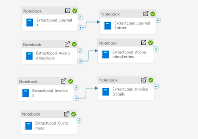
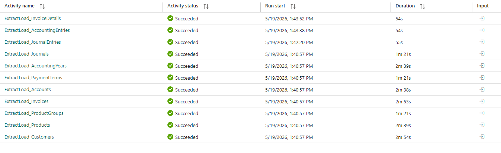
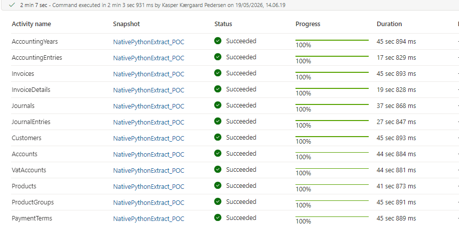

# When native Python beats a Spark cluster

In this post we explore the trade-offs between running data engineering workloads on the Spark engine versus native Python approaches. The distributed computing engine behind the Spark project is often the go-to when it comes to moving and transforming data throughout the data cycle. However, we went into the Data Lab to test whether there can be situations where alternatives perform better — or just as well — when it comes to resource usage and running time.

We started on our own data: a simple pipeline extracting data from our finance system through an available API. Initially we had a setup that persisted metadata configurations as a delta table, running as a PySpark notebook. The setup also included a generic notebook that ingests the raw data from the API, landing it as *JSON*, *XML*, or whatever format the API returned, without any transformations.

We wanted to make an experiment in the Data Lab where, instead of running the code on Spark clusters, we would use native *Python* versions of the notebooks. Spark was motivated by finding ways to work with large data payloads of thousands and millions of records, but that is not always the reality we work with. Particularly in the early stages of the data engineering lifecycle, we might work with small files extracted on a daily basis, which are later combined and merged into the existing data records we have. Distributing work across multiple worker nodes might not be worth the overhead with these smaller files, and that was what we wanted to test.

As data *nerds* we pride ourselves on making these types of experiments, so our solution designs are always chosen on the basis of tested conditions and not just because "that is what everyone else is doing". So let's look at the results.

Our pipeline had twelve different endpoints, with some of them having dependencies. For example, we load the invoice endpoint before the invoice details, because we need the list of invoice numbers to pass as parameters in the *URL* we send to get the details. Here is a little snippet of what this pipeline looks like.



When we look at the running time for this pipeline, we can see that it takes around 4 minutes — starting at 1:40:57 PM and finishing the last pipeline at approximately 1:44:48 PM.



The alternative was built in a similar fashion, but the notebook was modified to run using native Python libraries like pandas and PyArrow. To read and write from and to our OneLake lakehouses, a few libraries had to be imported, and some code changes were required to make the migration. Below is a snippet from our notebook with the modules and libraries we imported for this migration.

```python
import base64
import json
import notebookutils
import adlfs
import pandas as pd
import pyarrow as pa
import pyarrow.parquet as pq
import requests as req
from azure.core.credentials import AccessToken
from azure.storage.filedatalake import DataLakeFileClient
from datetime import datetime, timedelta
import time
```

Another change we made was to the orchestration. Instead of orchestrating the pipeline using Fabric pipelines, we used the *notebookutils* "run multiple notebooks" capability on a defined *DAG*. The reason for this was that if we used pipelines, we would have to start up a Python session with each notebook activity, which usually takes around 1 minute. That would defeat the purpose, as we would end up well above the 4 minute benchmark.

The result can be seen in the screenshot below. The entire pipeline took 2 minutes and 7 seconds — a **47% reduction** in running time. Shaving off close to 2 minutes is substantial for a small pipeline like this. If you have 10 of these API-extracting pipelines, that becomes nearly 20 minutes saved on every cycle. And if you run live updates throughout the day, that gap compounds with every run.




Speed is the visible win, but it is not the whole story. Here is the comparison side by side.

| | Spark | Native Python |
|---|---|---|
| Compute | 4-core cluster, 28 GB RAM | 2 vCores, 16 GB RAM |
| Wall-clock runtime | ~4:00 | 2:07 (≈47% faster) |
| Capacity draw | baseline | lower — smaller node, shorter run |

The native Python notebook ran on roughly half the cores and a smaller memory footprint, *and* it finished in roughly half the time. In Microsoft Fabric every workload draws on a shared capacity measured in Capacity Units, so a bigger machine running longer simply consumes more of the capacity you are paying for. A smaller node finishing sooner is cheaper on both axes at once.


The transferable lesson here is not "Python beats Spark", but to choose the right tool for the job.

Spark earns its keep when the payload — the actual data being shuffled, joined, and transformed — is large enough that spreading it across worker nodes outweighs the cost of coordinating them. When the payload is small, that coordination, plus session startup might not be worth it. The engine spends more effort getting ready to work than working.

So when a pipeline moves small files on a frequent schedule, it can be a candidate for a native Python implementation. Those Daily API extracts with smaller files tend to fit those criteria. Heavy nightly transformations over millions of rows usually do not.

## When Spark is still the right call

To be clear, this is not an argument against Spark. Spark is still the right tool when the data volume is genuinely large, when transformations are complex or shuffle-heavy (wide joins, large aggregations, windowing across big datasets).

The migration is not free either. Moving to native Python cost us real engineering effort — new libraries, code changes, and a hand-built orchestration DAG — and you give up some of the machinery Spark and Delta hand you out of the box, along with a clear ceiling on how far a single node will scale. The point is not to default away from Spark; it is to *choose*.


If this resonates, here is a concrete first step you can take without us: pull a list of your pipelines that move small files on a frequent schedule. Those are on the candidate list. 

If you are building your data platform and want help matching workloads to the right engine, you are welcome to contact us at datalab@thesmalldatalab.com.
